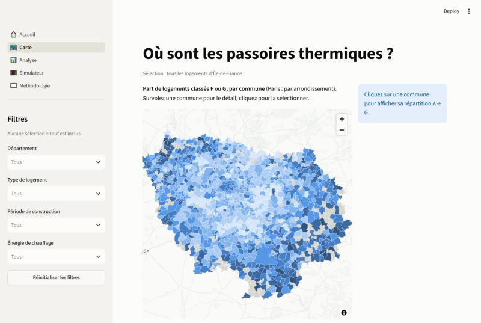
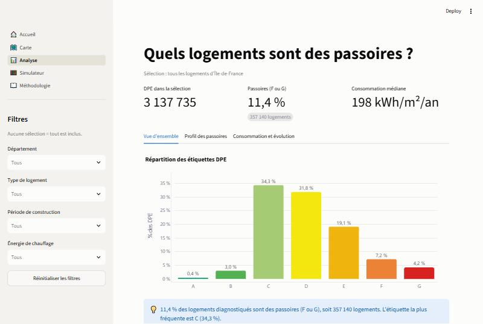
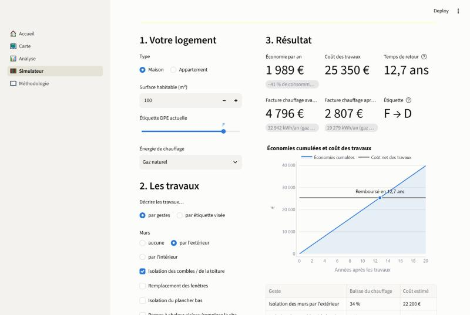

# Passoires thermiques en Île-de-France : où sont-elles et combien coûte leur rénovation ?

**Une application web qui cartographie les « passoires thermiques » d'Île-de-France à partir de 3,4 millions de diagnostics énergétiques (DPE) de l'ADEME, et qui simule les économies et le retour sur investissement d'une rénovation.**

🔗 **Application en ligne : [lien à ajouter après le déploiement]**



---

## Le problème

La loi Climat et Résilience interdit progressivement de louer les logements les moins performants : **G depuis 2025, F en 2028, E en 2034**. Pour un propriétaire, une collectivité ou un acteur de la rénovation, trois questions se posent :

1. Quelle part des logements franciliens est classée F ou G, et **où** ?
2. **Quels logements** sont les plus concernés (âge, chauffage, type, surface) ?
3. Pour un logement donné, **combien coûte une rénovation et en combien d'années est-elle rentabilisée** ?

## 5 insights clés

| # | Constat |
|---|---|
| 1 | **11,4 % des logements diagnostiqués sont des passoires (F ou G), soit 357 140 logements.** |
| 2 | **Le profil type est un petit logement ancien.** Les logements d'avant 1975 de moins de 50 m² représentent 26 % des DPE mais **55 % des passoires**. Avant 1948, 26,6 % sont F ou G, contre 0,3 % après 1989. |
| 3 | **Paris concentre 37 % des passoires de la région** (16,9 % de F+G, contre 7,5 % en Essonne). À type de logement égal, Paris reste deux fois plus touché que le reste de la région. |
| 4 | **Le chauffage compte autant que l'âge.** Au fioul, 64 % des logements sont F ou G, contre 3 % au chauffage urbain. Un appartement en chauffage individuel l'est presque deux fois plus souvent qu'en chauffage collectif (14 % contre 7,8 %). |
| 5 | **Deux géographies différentes.** En volume, les passoires sont dans le cœur urbain. En proportion, ce sont les communes rurales : sur les 151 communes qui dépassent 25 % de passoires, **89 sont en Seine-et-Marne**. |



## Recommandations

Pour une collectivité ou un acteur de la rénovation énergétique :

1. **Cible « volume » : les petits appartements anciens en chauffage individuel** à Paris et en petite couronne. C'est là que se trouve la majorité des passoires, et ce sont les logements les plus exposés à l'interdiction de louer. Leviers : isolation des murs, ventilation, remplacement des convecteurs électriques.
2. **Cible « taux » : les maisons rurales chauffées au fioul** (Seine-et-Marne, Vexin), dont 70 % sont des passoires. Le levier est clair : une pompe à chaleur, combinée à l'isolation. D'après le simulateur, c'est aussi le geste qui se rentabilise le plus vite.
3. **Prioriser les murs.** Dans les DPE franciliens, les murs représentent environ 40 % des pertes de chaleur d'un logement F ou G. C'est bien plus que les 20 à 25 % souvent cités.
4. **Les copropriétés en chauffage collectif** : leur taux de passoires est faible, mais un seul chantier traite des dizaines de logements.

## Le simulateur



L'utilisateur décrit son logement, puis ses travaux, **par gestes** (murs, combles, fenêtres, plancher bas, pompe à chaleur) ou **par étiquette visée**. Le simulateur calcule la facture avant et après, l'économie annuelle, le coût, le temps de retour et l'étiquette estimée.

- **Calibré sur les vrais DPE franciliens.** Plusieurs valeurs sont calculées via l'API de l'ADEME plutôt que reprises de moyennes génériques : la consommation des logements comparables, la part de chaque paroi dans les pertes de chaleur, l'effet mesuré d'une bonne isolation et le rendement des chaudières.
- **Hypothèses sourcées et modifiables.** Elles sont regroupées dans [`config/hypotheses.yaml`](config/hypotheses.yaml) : prix CRE de l'électricité et du gaz, relevé DGEC du fioul, SCOP mesuré par l'ADEME, coût Anah d'une rénovation d'ampleur. Les valeurs sans source officielle sont signalées ⚠️.
- **Logique testée** : 31 tests unitaires ([`tests/test_simulateur.py`](tests/test_simulateur.py)).
- ⚠️ *C'est une estimation pédagogique : elle ne remplace pas un audit énergétique.*

## Stack et méthodologie

| Étape | Outils | Fichiers |
|---|---|---|
| Collecte via l'API ADEME (filtrée sur l'IDF, contrôle du nombre de lignes) | Python, requests | [`src/collecte.py`](src/collecte.py) |
| Nettoyage, une règle par étape avec journal chiffré | **SQL** (DuckDB) | [`sql/nettoyage.sql`](sql/nettoyage.sql), [`docs/nettoyage.md`](docs/nettoyage.md) |
| Indicateurs, une requête par question business | **SQL** (DuckDB) | [`sql/analyse/`](sql/analyse/) |
| Graphiques et phrases d'insight calculées | Plotly, pandas | [`src/graphiques.py`](src/graphiques.py), [`src/insights.py`](src/insights.py) |
| Carte par commune | pydeck, API Géo, shapely | [`app/pages/carte.py`](app/pages/carte.py) |
| Simulateur | Python, pytest, YAML | [`src/simulateur.py`](src/simulateur.py) |
| Application (5 pages, filtres partagés, cache) | Streamlit | [`app/`](app/) |

**Points de méthode marquants :**
- **Dédoublonnage réfléchi.** Une règle naïve (« garder le DPE le plus récent par logement ») aurait supprimé 34 % des données. Elle aurait aussi gonflé le taux de passoires de 11,4 % à 14,5 %, car elle confondait des appartements identiques diagnostiqués en lot avec des doublons. La règle retenue ne fusionne que les vrais re-diagnostics.
- **Réforme 2026 vérifiée dans les données.** Le coefficient de l'électricité est passé de 2,3 à 1,9. Le rapport énergie primaire / énergie finale montre que l'ADEME publie les anciens DPE déjà recalculés.
- **Piège d'interprétation évité.** La hausse récente de la part de passoires vient de la composition des DPE réalisés (plus de logements anciens diagnostiqués depuis 2025), pas d'une dégradation du parc.

## Limites

- **Biais de sélection.** Un DPE est réalisé surtout lors d'une vente ou d'une location. Les données décrivent les logements mis sur le marché depuis 2021, pas tout le parc.
- **Consommation conventionnelle.** Le DPE suppose un usage standard. Les occupants de passoires chauffent souvent moins que prévu, donc les économies réelles peuvent être plus faibles que celles simulées.
- **Simulateur.** Il ne modélise que le chauffage, pas le seuil d'émissions de CO₂ de l'étiquette, ni les aides (à saisir par l'utilisateur). Certains coûts de travaux viennent de comparateurs privés, faute de barème officiel.

Détails : page *Méthodologie* de l'application, [`docs/nettoyage.md`](docs/nettoyage.md), [`docs/insights.md`](docs/insights.md), [`docs/simulateur.md`](docs/simulateur.md).

## Lancer le projet en local

```bash
git clone <url-du-depot>
cd renovation-energetique-idf
pip install -r requirements.txt
streamlit run app/streamlit_app.py
```

L'application fonctionne directement avec les données allégées versionnées (`data/processed/dpe_idf_app.parquet`, 14 Mo). Pour tout régénérer depuis l'API de l'ADEME, comptez environ 30 minutes de téléchargement :

```bash
python src/collecte.py                # 3,4 M de DPE → data/raw/ (environ 240 Mo, non versionné)
python src/nettoyage.py               # nettoyage SQL → data/processed/dpe_idf.duckdb
python src/preparer_carte.py          # contours de communes simplifiés
python src/references_simulateur.py   # valeurs de référence du simulateur (API ADEME)
python src/preparer_deploiement.py    # version allégée pour l'application
python src/analyse.py                 # rapport d'analyse HTML (docs/rapport_analyse.html)
python -m pytest                      # tests du simulateur
```

## Source des données

[DPE Logements existants (depuis juillet 2021)](https://www.data.gouv.fr/datasets/dpe-logements-existants-depuis-juillet-2021/), ADEME, licence ouverte. Données extraites le 22/10/2026. Contours : [API Géo](https://geo.api.gouv.fr).

---

*Projet réalisé par Gabriel, Data / Business Analyst.*
